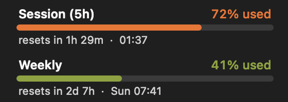
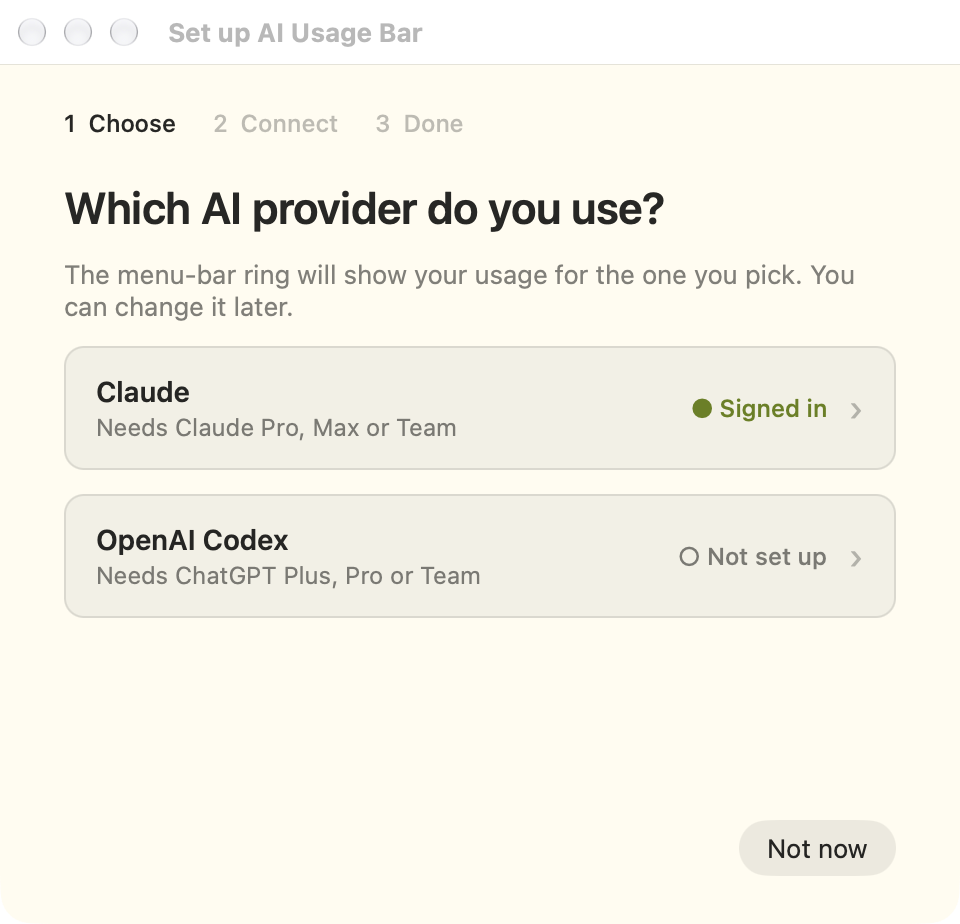
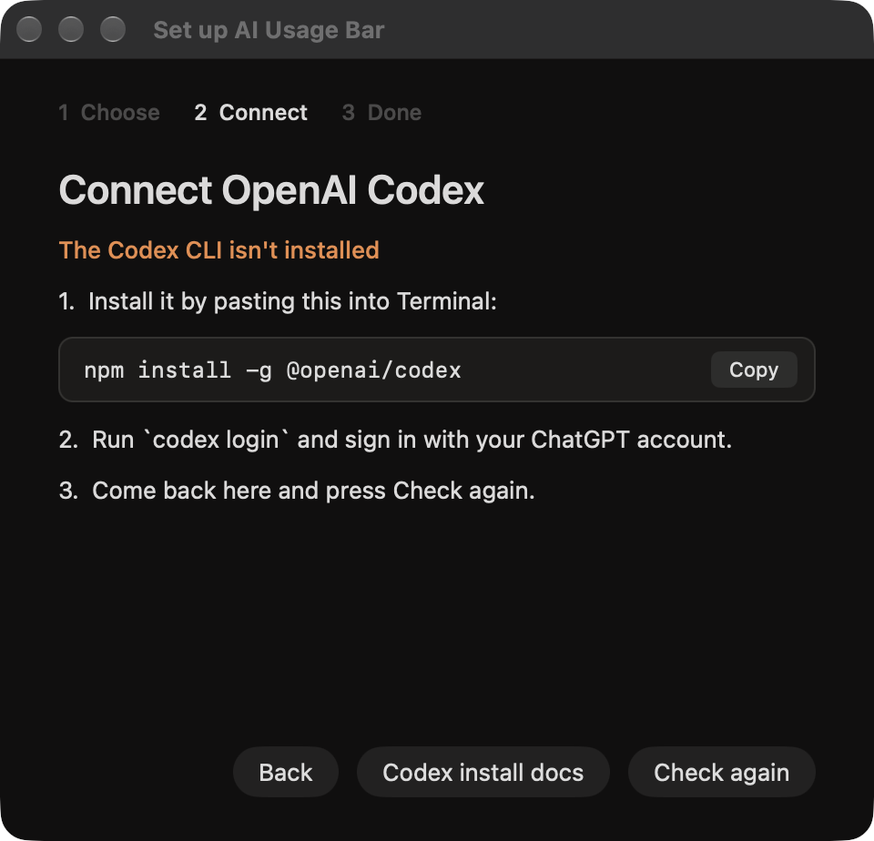
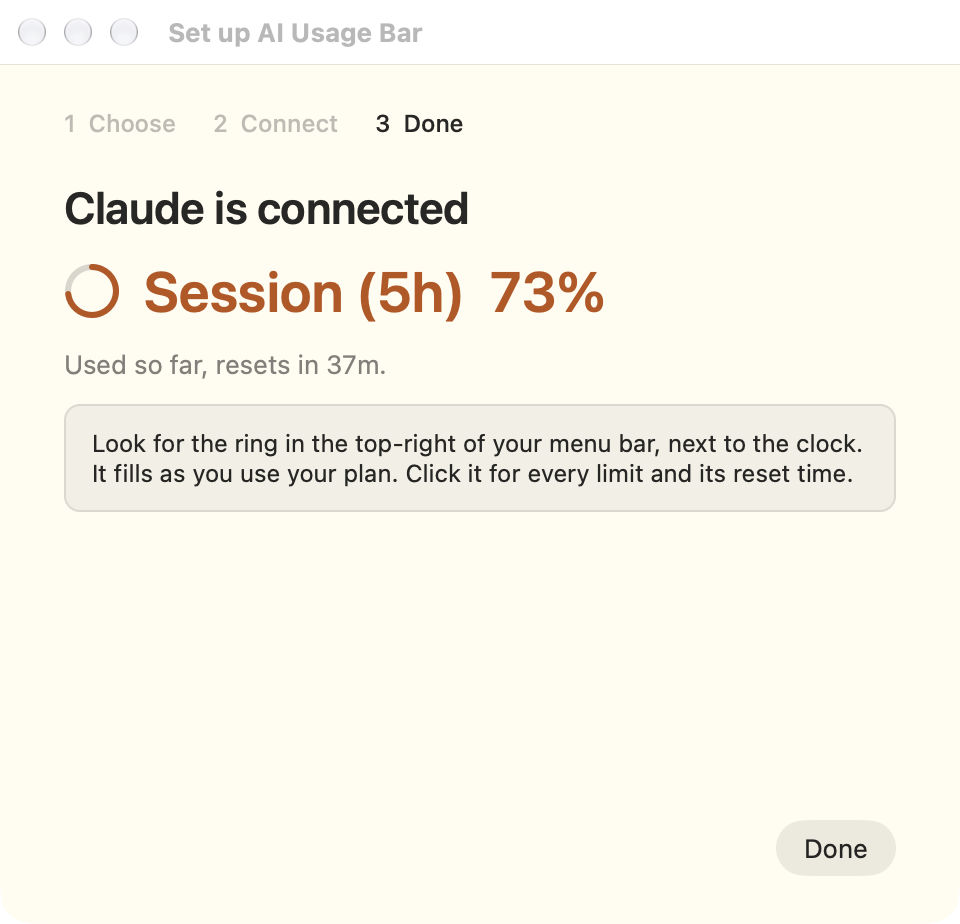

# AI Usage Bar

A tiny macOS menu-bar app that shows how much of your AI plan's usage limit you've used — so you stop opening settings pages to check.


The ring fills as you use your current session window and changes colour as you approach the limit. Click it for every limit, with reset times:



| Used | Colour |
|---|---|
| under 50% | green |
| 50–69% | yellow |
| 70–89% | orange |
| 90%+ | red |

Colours are [Flexoki](https://stephango.com/flexoki) by Steph Ango, and follow light/dark mode.

## Providers

Pick one from **Provider** in the dropdown.

| Provider | Needs | Bar shows | Status |
|---|---|---|---|
| **Claude** (Pro / Max / Team) | Signed in to the Claude desktop app or Claude Code | 5-hour session | Tested with a live account |
| **OpenAI Codex** (ChatGPT plans) | `codex login` with your ChatGPT account | Primary (5-hour) window | Tested against a mock of the API ([`tests/`](tests)); not yet with a live account |

Both use the same undocumented endpoints the official apps use for their own usage screens, so a provider update can break them. When that happens the bar shows `!` and the dropdown shows the error.

### How credentials are handled

- **Claude:** reads the OAuth login from the macOS keychain (`Claude Code-credentials`, via `/usr/bin/security`) or `~/.claude/.credentials.json`. If the access token has expired it refreshes it and writes the new tokens back to both places, so Claude stays signed in.
- **Codex:** reads `$CODEX_HOME/auth.json` (default `~/.codex`). It never refreshes tokens; run `codex` once if the session has expired.

Tokens are only sent to the provider's own API. Nothing else leaves your Mac.

## Install

Needs macOS 13+ and the Xcode Command Line Tools (`xcode-select --install`).

```sh
git clone https://github.com/digitallymarked/ai-usage-bar.git
cd ai-usage-bar
./install.sh
```

This builds `~/Applications/AIUsageBar.app` and adds a LaunchAgent so it starts at login (and relaunches if it crashes). Choosing **Quit** keeps it closed until your next login.

```sh
./install.sh --build       # build only → build/AIUsageBar.app
./install.sh --uninstall   # remove app and login item
```

It refreshes every 2 minutes, when you open the menu, and after the Mac wakes.

### First run

The first time it opens, a short wizard asks which provider you use and walks you through connecting it — detecting your login, telling you what to install or sign in to if it's missing, and finishing only once a real usage reading comes back.

  

Already signed in? It's two or three clicks. Re-run it any time from **Set up provider…** in the dropdown. If you used an earlier version, your saved provider is kept and the wizard is skipped.

## Development

```sh
swiftc -O -o build/AIUsageBar Sources/*.swift -framework Cocoa
build/AIUsageBar --snapshot claude out.png   # fetch live data, print it, render the dropdown to a PNG
tests/test_codex.sh                          # Codex provider against a local mock
```

### Adding a provider

Implement `UsageProvider` (see `Sources/Model.swift`) and add it to `Providers.all`. The setup wizard is built from the same list, so the new provider appears in it automatically. `planRequired` and `setupStatus()` drive its card and connect step (`setupStatus` must detect credentials without a network call or reading secrets):

```swift
struct MyProvider: UsageProvider {
    let id = "my-ai"
    let name = "My AI"
    let usagePageURL = URL(string: "https://example.com/usage")!
    let planRequired = "My AI Pro"
    func setupStatus() -> SetupStatus {
        MyCreds.exists ? .signedIn : .needsSetup(SetupGuide(
            headline: "Not signed in to My AI",
            steps: ["Install and sign in to the My AI app.", "Come back and press Check again."],
            actions: [SetupAction(title: "Download My AI", kind: .openURL(URL(string: "https://example.com/get")!))]))
    }
    func fetch() async throws -> UsageSnapshot {
        // primary drives the menu-bar ring; others are listed in the dropdown
        UsageSnapshot(primary: LimitInfo(label: "Daily", percent: 12, resetsAt: nil), others: [], fetchedAt: Date())
    }
}
```

## License

MIT. Not affiliated with Anthropic or OpenAI.
